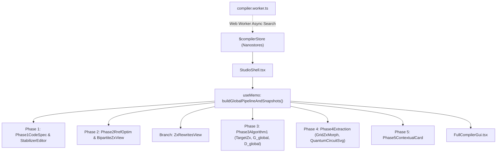

# LLM & AI Agent Development Guide for SpiderCSS Docs

> **Scope**: This document is the authoritative engineering guide for LLMs, AI coding assistants, and human developers contributing to or maintaining the SpiderCSS interactive companion website and visual compiler located in `docs/`.

---

## 1. Project Context & Status

- **Project Status**: **Active Development Phase**.
  - All core compiler modules, interactive visualizers, and benchmark explorers are operational and tested against the reference Python library.
  - Active work focuses on **UI/UX improvements, feature enhancements, visual refinements, performance optimizations, and codebase maintainability**.

---

## 2. Domain Knowledge Primers (The Quantum & Graph Theory)

Before writing or editing code, understand these fundamental concepts:

### A. CSS Codes & Target Logical States
- A CSS code is defined by binary parity-check matrices $H_X$ and $H_Z$ satisfying the commutativity condition:
  $$H_X H_Z^T = 0 \pmod 2$$
- Fault-tolerance distance $d$ determines the number of correctable errors:
  $$t = \lfloor(d - 1) / 2\rfloor$$
- **Target Basis**:
  - Preparing $|\overline{0}\rangle$ ($Z$-basis) uses the active parity-check matrix $M = H_X$ with $X$-type spiders.
  - Preparing $|\overline{+}\rangle$ ($X$-basis) uses the active parity-check matrix $M = H_Z$ with $Z$-type spiders.

### B. Phase 2: RREF Basis Optimization & Eq. (8) CNOT Cost
- To minimize the CNOT cost of state preparation, SpiderCSS permutes matrix columns, performs Gaussian elimination over GF(2) to find an RREF form with **unique-one pivot columns**, and un-permutes the columns:
  - Pivot columns have weight 1 and can be prepared as trivial single-qubit states.
  - Non-pivot columns have weight $w_i > 1$ and require cat states.
- CNOT cost (Paper Eq. 8):
  $$\text{CNOTs} = \sum_{j} (\text{cat\_size}(w_j) - 1) + \text{ancillas}$$
- **Perfect Codes**: For codes like Steane $[[7,1,3]]$ or Golay $[[23,1,7]]$, non-pivot spiders can be unfused at fault-distance $t - 1$ instead of $t$, reducing CNOT count while maintaining fault tolerance.

### C. Phase 3: Algorithm 1 Joint Graph & DAG Synthesis (**NO Backtracking**)
- Algorithm 1 (Paper Section IV) incrementally builds two data structures in lockstep:
  1. **Global Undirected Graph $G_{\text{global}}$**: Spiders initialized from 3-ary cat states, connected by a spanning forest $F$, with root nodes $r_k$ outlined in blue, plus external CNOT edges added for each logical edge.
  2. **Global Causal Dependency DAG $D_{\text{global}}$**: Directed acyclic graph ensuring a valid topological execution schedule. Contains:
     - Solid black edges: Internal cat-state tree edges.
     - Dashed red edges: `missing_link` flag ordering edges to detect hook errors.
     - Dashed orange edges: External causal edges $P_{D}(u(a)) \to u(b)$ and $P_{D}(u(b)) \to u(a)$ added for each CNOT.
- **CRITICAL INVARIANT**: Algorithm 1 operates **strictly without backtracking**. The traversal DAG $D_{\text{global}}$ guarantees acyclicity by construction through the heuristic edge selection order.

### D. Phase 4: 3-Way Qubit Reuse
- When synthesizing physical quantum circuits from $G_{\text{global}}$ and $D_{\text{global}}$, SpiderCSS supports three reuse strategies:
  1. `'None'`: All ancilla qubits allocated simultaneously (maximum parallelism, highest qubit footprint).
  2. `'depth'`: Eagerly reuses ancillas as soon as measurements complete to minimize circuit depth.
  3. `'qubits'`: Maximizes ancilla recycling to minimize peak simultaneous physical qubits.

---

## 3. Architecture & State Flow



### A. State Management (`src/stores/compilerStore.ts`)
- **Single Source of Truth**: All top-level parameters are managed via `$compilerStore`:
  - `mode`: `'walkthrough' | 'gui'`
  - `selectedPresetId`: preset ID or `'custom'`
  - `basis`: `'Z' | 'X'`
  - `H_x`, `H_z`, `d`, `validation`
  - `rrefSnapshot`, `bestMatrix`, `maxBasisTries`
  - `routingHeuristic`, `customEdgeOrder`, `alg1StepIndex`
  - `reuseTarget`: `'None' | 'depth' | 'qubits'`
- **Store Mutators**: Exported functions (`selectPreset`, `setTargetBasis`, `setCodeDistance`, `updateCustomMatrices`, `setStudioMode`, `setAlg1StepIndex`, `setReuseTarget`, etc.).
- **Immutability Rule**: Always return cloned copies of matrices and objects (`cloneMatrix(M)`, `{ ...cur, ... }`). **Never mutate matrices in-place.**

### B. Computation Pipeline (`src/engine/spiderLegMatcher.ts`)
- `buildGlobalPipelineAndSnapshots({ H, d, basis, analyzeHookErrors, routingHeuristic, customEdgeOrder, reuseTarget, seed })`:
  - Takes the active parity matrix and configuration.
  - Executes Algorithm 1 step-by-step.
  - Precomputes step snapshots for the Phase 3 scrubber.
  - Extracts the circuit across all 3 reuse targets for Phase 4.
  - Memorized inside `StudioShell.tsx` via `useMemo`.

### C. Web Worker (`src/engine/compiler.worker.ts`)
- Offloads CPU-intensive operations (such as Monte Carlo basis searches over hundreds of random column permutations) to a background thread to prevent UI jank.
- Communicates via typed messages: `OPTIMIZE_MATRIX` and `COMPILE_CIRCUIT`.

---

## 4. Source Code Map

| Directory / File | Role & Key Exports |
| :--- | :--- |
| `src/stores/compilerStore.ts` | Reactive Nanostores store `$compilerStore` + action dispatches |
| `src/engine/types.ts` | Canonical TypeScript interfaces (`BinaryMatrix`, `QeccPreset`, `CostBreakdown`, etc.) |
| `src/engine/gf2.ts` | GF(2) linear algebra: `rrefGF2`, `nullSpaceGF2`, `solveLinearSystemGF2`, `SeededRng` |
| `src/engine/cssState.ts` | CSS code validation, Pauli string parsing, perfect code detection |
| `src/engine/optimizeParityMatrix.ts` | `rowOptimizeMatrix`, `performSingleRrefTrial`, `detailedCostBreakdown`, Eq. (8) |
| `src/engine/hookErrors.ts` | `characterizeStabilizerSplits`, safe hook-error split analysis |
| `src/engine/catState.ts` | Well-ordered cat state loader, DAG traversal helpers |
| `src/engine/heuristics.ts` | Edge ordering heuristics (`criticalPathFirstOrder`, `saSequenceDistanceOrder`, etc.) |
| `src/engine/spiderLegMatcher.ts` | Core Algorithm 1 runner & `buildGlobalPipelineAndSnapshots` |
| `src/engine/circuitExtraction.ts` | Extraction algorithm, `StimCircuitBuilder`, `formatQasmCircuit` |
| `src/engine/qubitReuse.ts` | 3-way qubit reuse scheduling: `compileFromGlobalPipeline` |
| `src/components/StudioShell.tsx` | Main studio coordinator toggling Walkthrough vs GUI modes |
| `src/components/phase1/` | `Phase1CodeSpec.tsx` (preset picker), `StabilizerEditor.tsx` (matrix/Pauli editor) |
| `src/components/phase2/` | `Phase2RrefOptim.tsx`, `MatrixStepViewer.tsx`, `BipartiteZxView.tsx`, `CostBreakdownCard.tsx` |
| `src/components/branch/` | `ZxRewritesView.tsx` (ZX-rewrites theory branch view) |
| `src/components/phase3/` | `Phase3Algorithm1.tsx`, `TargetZxPanel.tsx`, `GlobalGraphPanel.tsx`, `GlobalDagPanel.tsx` |
| `src/components/phase4/` | `Phase4Extraction.tsx`, `GridZxMorphCanvas.tsx`, `QuantumCircuitSvg.tsx`, `CircuitExportBox.tsx` |
| `src/components/phase5/` | `Phase5Benchmarks.tsx`, `LerComparisonPlot.tsx`, `Phase5ContextualCard` |
| `src/components/gui/` | `FullCompilerGui.tsx` (direct synthesis interface) |
| `src/styles/global.css` | Tailwind v4 entrypoint, TikZ color variables, scrollbar styles |
| `scripts/sync-assets.mjs` | Data sync script extracting presets and simulations from Python package |
| `tests/engineParity.test.ts` | Vitest suite verifying TS engine results against Python reference |

---

## 5. Non-Negotiable Invariants & Rules for LLMs

1. **Parity with Python `spidercss`**:
   - The TypeScript engine in `src/engine/` must match Python `spidercss/` output identically.
   - Any modification to compiler logic must pass `npm test` (`tests/engineParity.test.ts`).
2. **Never Reintroduce Backtracking**:
   - Phase 3 operates strictly following Algorithm 1 without backtracking.
3. **No Direct State Mutation**:
   - Binary matrices are 2D arrays (`number[][]`). Modifying `matrix[r][c] = 1` in-place without cloning breaks React reactivity in Nanostores. Always use `cloneMatrix(M)`.
4. **Tailwind CSS v4 Standards**:
   - This project uses Tailwind CSS v4.
   - **Do NOT create `tailwind.config.js` or `tailwind.config.mjs`**. Configuration is in `src/styles/global.css` via `@import "tailwindcss";` and `@theme`.
   - Do not use deprecated Tailwind v3 arbitrary utility patterns that conflict with v4.
5. **No Node APIs in Frontend Modules**:
   - `src/` runs purely in the client browser. Do not import `node:fs`, `node:path`, or any Node modules in `src/`. Node APIs are strictly restricted to `scripts/sync-assets.mjs`.
6. **TikZ Color Token Consistency**:
   - All ZX diagrams and graph visualizers must use the standard CSS color tokens defined in `src/styles/global.css`:
     - $Z$-spiders: fill `var(--zx-green-fill)` (`#86efac`), stroke `var(--zx-green-stroke)` (`#15803d`).
     - $X$-spiders: fill `var(--zx-red-fill)` (`#fca5a5`), stroke `var(--zx-red-stroke)` (`#b91c1c`).
     - Internal idealized edges: `var(--zx-ideal-purple)` (`#9333ea`).
     - Spanning forest $F$ bold edges: `var(--zx-forest-bold)` (`#0f172a`), width `3.2px`.
     - Cat state root nodes: stroke `var(--zx-root-blue)` (`#2563eb`), width `3px`.
     - DAG missing link edges: `var(--dag-missing-link-red)` (`#dc2626`).
     - DAG external causal edges: `var(--dag-added-causal-orange)` (`#ea580c`).

---

## 6. Recipes for Common Development & Improvement Tasks

### Recipe 1: Enhancing an Interactive Visualization (e.g. Matrix, ZX, or DAG Panel)
1. Locate the component in `src/components/phase{1..5}/`.
2. Inspect how SVG dimensions and viewBox are handled:
   - Use dynamic scaling or responsive viewBoxes.
   - Wrap panels in `.square-panel-wrapper` and `.square-panel-scroll` to support fluid responsiveness.
3. Ensure tooltips or hover states use accessible HTML/SVG overlays.
4. If animations are used, prefer Framer Motion or pure CSS transitions.

### Recipe 2: Adding a New Routing Heuristic
1. Define the heuristic function in `src/engine/heuristics.ts` (signature: `(edges: LogicalEdge[], gGlobal: GlobalGraph, dGlobal: GlobalDag, ...) => LogicalEdge[]`).
2. Add the heuristic identifier to `RoutingHeuristicType` in `src/engine/types.ts`.
3. Wire the heuristic into `buildGlobalPipelineAndSnapshots` in `src/engine/spiderLegMatcher.ts`.
4. Add the user-facing option to the heuristic `<select>` dropdown in `Phase3Algorithm1.tsx` and `FullCompilerGui.tsx`.
5. Run `npm test` to verify that existing heuristics and tests remain unaffected.

### Recipe 3: Adding or Modifying QECC Presets
1. Place or edit JSON files in `../spidercss/assets/qeccs/{FAO,MQT,misc}/{code_id}.json`.
2. Run `npm run sync-data` from `docs/` (or `npm --prefix docs run sync-data`).
3. Verify that `docs/src/generated/qeccsIndex.json` is updated with valid `H_x`, `H_z`, `d`, and `full_name`.
4. Run `npm test` and `npm run build`.

### Recipe 4: Updating Simulation Benchmarks
1. Place new simulation run JSONs in `../spidercss/simulation_results/`.
2. Run `npm run sync-data`.
3. The script will automatically compute Wilson 95% score confidence intervals and update:
   - `docs/src/generated/simulationSummary.json`
   - `docs/public/data/simulation_results/by_code/{code}.json`
4. Inspect the resulting plots in `#benchmarks` by running `npm run dev`.

### Recipe 5: Improving Full Compiler GUI Mode
1. Component is in `src/components/gui/FullCompilerGui.tsx`.
2. It interacts directly with `$compilerStore` and uses the same pipeline as the Walkthrough mode.
3. Keep the layout compact and card-based with quick copy/export buttons for Stim and OpenQASM.

---

## 7. Verification Checklist

Whenever you make changes to the codebase, execute this verification checklist:

```bash
# 1. Run Vitest parity test suite
npm --prefix docs test

# 2. Re-synchronize assets if data or scripts were modified
npm --prefix docs run sync-data

# 3. Test production static build (catches TypeScript and Vite bundling errors)
npm --prefix docs run build
```

Both `npm test` and `npm run build` **must exit with code 0** before finalizing any modification.
